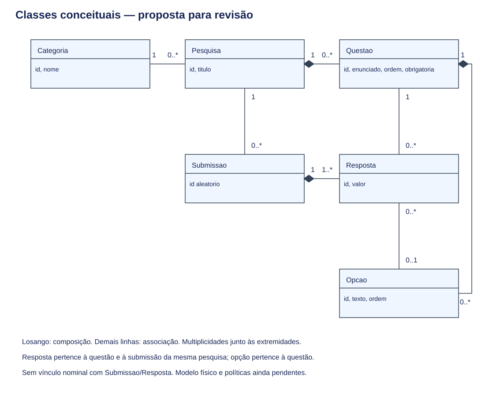
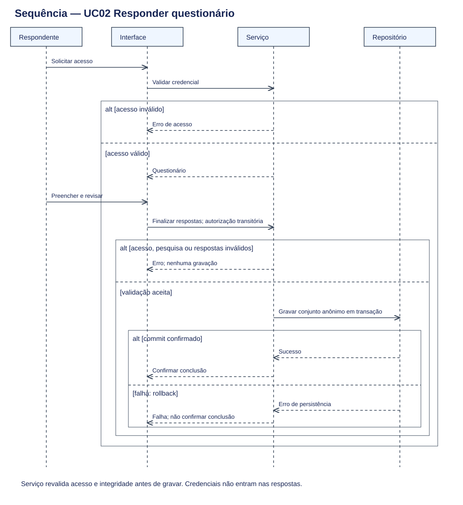

# Especificação UML

Proposta conceitual para revisão — 21/10/2026. Referência: [requisitos e fontes](../requisitos.md). Não é esquema físico nem implementação.

## Classes

| Classe | Atributos conceituais | Responsabilidade |
|---|---|---|
| Categoria | id, nome | Classificar pesquisas |
| Pesquisa | id, titulo | Agrupar questões e submissões |
| Questao | id, enunciado, ordem, obrigatoria | Descrever item do questionário |
| Opcao | id, texto, ordem | Representar escolha disponível |
| Submissao | id aleatorio | Agrupar respostas de um envio anônimo |
| Resposta | id, valor | Registrar resposta a uma questão |

Pesquisa, Questão, Resposta e Categoria vêm da issue #2; Opção da #3. Submissão e os atributos são propostas. Nesta versão, assume-se resposta de escolha única: cada Resposta pode selecionar zero ou uma Opcao; valor é usado para texto. Tipos de questão e múltipla escolha precisam ser validados antes de converter o modelo em tabelas.

Cardinalidades: Categoria 1 — 0..* Pesquisa; Pesquisa 1 compõe 0..* Questao e possui 0..* Submissao; Questao 1 compõe 0..* Opcao e recebe 0..* Resposta; Submissao 1 compõe 1..* Resposta; Opcao 0..1 — 0..* Resposta. Cada pesquisa tem uma categoria na proposta; rascunhos podem não ter questões. Cada resposta pertence a uma questão e uma submissão. Uma submissão finalizada deve conter todas as respostas obrigatórias.

Restrições: no máximo uma resposta por questão em cada submissão; questão e submissão pertencem à mesma pesquisa; opção selecionada pertence à questão respondida; questões/opções referenciadas não podem ser apagadas sem política explícita. Uma resposta de escolha exige opção e não texto; uma resposta textual usa valor e não opção. Estes invariantes deverão ser verificados no servidor e na futura modelagem de dados.

O losango preenchido representa composição, com ciclo de vida controlado pelo todo; não prescreve exclusão em cascata no banco. Não há vínculo entre Submissao/Resposta e usuário, senha, convite ou sessão autenticada. Categoria–Pesquisa, Questao–Resposta e Opcao–Resposta são associações simples.

## Sequência — UC02

Participantes: Respondente, Interface, Serviço e Repositório de respostas. A credencial é verificada pelo serviço, sem incluí-la no objeto anônimo persistido.

1. Respondente solicita acesso; Interface envia credencial ao Serviço.
2. Se inválida, Serviço retorna erro e não libera o questionário. Se válida, retorna o questionário.
3. Respondente preenche e revisa; Interface envia respostas com autorização transitória.
4. Serviço revalida acesso, disponibilidade da pesquisa e integridade do questionário. Se inválido, retorna erro sem persistência.
5. Serviço grava atomicamente submissão e respostas anônimas. Não encaminha credenciais, IP ou identidade ao repositório de respostas.
6. Confirmação só é exibida após sucesso da transação; falha produz rollback e mensagem de erro.

Os fragmentos `alt` do SVG representam caminhos mutuamente exclusivos. As setas tracejadas representam retorno. Reenvios da mesma solicitação devem ser idempotentes; estratégia transitória e prazo de deduplicação ainda precisam ser definidos sem criar vínculo persistente nominal com respostas. Não há garantia de uma resposta por pessoa nesta modelagem.

## Rastreabilidade

| Requisitos | Elementos |
|---|---|
| RF01, RF07 | UC01; Pesquisa, Categoria, Questao e Opcao |
| RF02–RF05, RF09 | UC02 e sequência; Submissao e Resposta |
| RF06, RF08 | UC03 e autorização de gestão; agregação a detalhar |
| RNF01 | Ausência de entidade nominal associada a respostas; separação dos dados na sequência |

RNF02–RNF05 exigem validações de interface, carga e segurança que diagramas UML não demonstram.

[Registro de verificação](../verificacao.md)