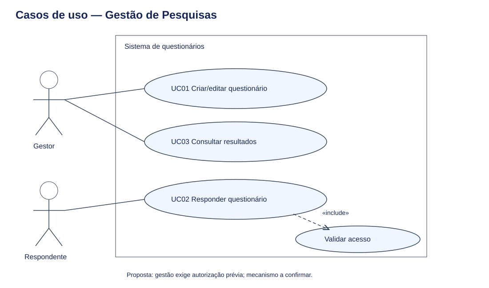

# Requisitos — Gestão de Pesquisas por Questionários

Versão para revisão acadêmica — 21/10/2026. Levantamento documental; não houve entrevista nem validação com usuários. Não representa implementação.

## Fontes e situação inicial

Inspeção de `Fatec-Extensao/pi-ads-2026-2-igor`, base `ab0540f`, README principal e do semestre, arquivos das disciplinas e issues #1–#12. Os documentos de requisitos, UML, banco e sitemap eram reservas de conteúdo. As issues #1, #3 e #6 têm checklists marcados, mas os respectivos artefatos não constam nessa base. Marcação de checklist não foi tratada como evidência de entrega. Esta proposta usa o padrão de organização do Bispo, sem importar decisões específicas daquele projeto.

Fontes: [requisitos #1](https://github.com/Fatec-Extensao/pi-ads-2026-2-igor/issues/1), [UML #2](https://github.com/Fatec-Extensao/pi-ads-2026-2-igor/issues/2), [entidades #3](https://github.com/Fatec-Extensao/pi-ads-2026-2-igor/issues/3), [interface #6](https://github.com/Fatec-Extensao/pi-ads-2026-2-igor/issues/6), [formulários #8](https://github.com/Fatec-Extensao/pi-ads-2026-2-igor/issues/8) e [privacidade #11](https://github.com/Fatec-Extensao/pi-ads-2026-2-igor/issues/11).

**D:** exigência documentada; detalhes operacionais são elaborados para revisão. **P:** proposta ainda não confirmada. Todas as condições abaixo são critérios esperados, sem alegação de teste do sistema.

## Atores

| Ator | Responsabilidade | Origem |
|---|---|---|
| Gestor | Criar questionários e consultar resultados autorizados | P: papel sugerido a partir da issue #1 |
| Respondente | Validar acesso e preencher questionário | D: #1, #2, #6 |

Autenticação do gestor, propriedade das pesquisas e administração de permissões precisam de definição.

## Requisitos funcionais

| ID | Requisito | Origem | Critério de aceitação proposto |
|---|---|---|---|
| RF01 | Criar e editar questionário com questões e opções | D: #1, #3 | Salvar questionário válido; rejeitar título ou questão sem conteúdo |
| RF02 | Autenticar ou validar acesso do respondente | D: #1, #6 | Acesso inválido não libera preenchimento; mecanismo de senha ou convite a confirmar |
| RF03 | Exibir questões e permitir avanço e retorno | D: #8 | Navegação preserva respostas durante a sessão |
| RF04 | Validar campos obrigatórios antes de finalizar | D: #8; servidor P | Formulário incompleto não é aceito no cliente nem no servidor |
| RF05 | Registrar respostas anônimas | D: #1, #3 | Respostas persistidas não contêm identificador de pessoa ou credencial de acesso |
| RF06 | Gerar relatórios estatísticos | D: #1, #5 | Contagens por questão e opção correspondem às submissões finalizadas |
| RF07 | Associar pesquisa a categoria | D: #2, #3; operação P | Categoria existente pode classificar pesquisa; cardinalidade a validar |
| RF08 | Restringir edição e relatórios a gestores autorizados | P | Acesso direto sem permissão é recusado no servidor |
| RF09 | Finalizar o conjunto de respostas atomicamente | P | Falha não deixa submissão parcial; repetição da mesma solicitação não duplica respostas |

RF09 não garante uma única participação por pessoa. A política de repetição e sua compatibilidade com anonimato permanecem pendentes.

## Requisitos não funcionais

| ID | Requisito | Origem | Verificação proposta |
|---|---|---|---|
| RNF01 | Separar controle de acesso de respostas anônimas | D: #1, #11; desenho P | Inspecionar modelo, persistência e logs: nenhum vínculo nominal com submissões |
| RNF02 | Oferecer layout responsivo | D: #1, #7 | Verificar 360 px e 1280 px sem perda de controles ou rolagem horizontal |
| RNF03 | Oferecer acessibilidade básica | D: #7 | Navegação por teclado, rótulos associados e foco visível; contraste deve ser verificado |
| RNF04 | Atender tempo de resposta acordado | D: #1; meta P | Proposta: p95 até 2 s para carregar questionário com até 30 questões e 20 usuários simultâneos; ambiente e meta dependem de aprovação |
| RNF05 | Proteger acesso e entradas | P | HTTPS em produção, autorização no servidor e consultas parametrizadas verificadas em testes |

Não há avaliação jurídica nem garantia de anonimato absoluto. Retenção, exclusão, aviso de privacidade, infraestrutura e riscos de reidentificação por conteúdo e horários deverão ser definidos na disciplina responsável.

## Casos de uso

| ID | Ator | Fluxo principal | Exceções |
|---|---|---|---|
| UC01 | Gestor | Acessar gestão autorizada, criar pesquisa, adicionar questões/opções e salvar | Conteúdo inválido ou falta de permissão: recusar |
| UC02 | Respondente | Validar acesso, preencher, revisar e finalizar | Credencial inválida, campo ausente ou erro de gravação: não confirmar conclusão |
| UC03 | Gestor | Acessar relatório autorizado, selecionar pesquisa e consultar agregados | Sem permissão: recusar; sem submissões: apresentar resultado vazio |

Pré-condição de UC02: pesquisa disponível e questionário configurado. Pós-condição de sucesso: uma submissão completa com respostas anônimas; falha de gravação desfaz o conjunto. Publicação, encerramento e regras de edição após respostas estão pendentes.

O diagrama apresenta autenticação de acesso como inclusão de UC02. A gestão autorizada é pré-condição de UC01 e UC03, sem presumir o mecanismo de login do gestor.

## Pendências para validação

- Confirmar integrantes, usuário responsável, enunciado e público da pesquisa.
- Definir tipos de questão, obrigatoriedade, múltipla escolha e respostas livres.
- Definir método de acesso, participação repetida e recuperação de sessão.
- Definir quem cria pesquisas e quem consulta resultados; política de grupos pequenos.
- Validar categorias, edição após submissões, desempenho, retenção e política de logs.

[Especificação UML](./modelagem-uml/especificacao.md) · [Verificação](./verificacao.md)