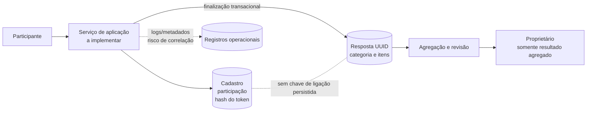

# Privacidade, LGPD e anonimato

- **Projeto:** Sistema Web para Gestão de Pesquisas por Questionários
- **Escopo:** sistema acadêmico 2026-2 e seu modelo de dados
- **Issue:** [#11 — Relatório de Adequação à LGPD e Mecanismos de Anonimato](https://github.com/Fatec-Extensao/pi-ads-2026-2-igor/issues/11)
- **Revisão:** 11 de novembro de 2026

## 1. Objetivo e limites

Este documento descreve os dados previstos no modelo, as finalidades do tratamento, os mecanismos de separação entre identidade e resposta, uma política proposta de retenção e exclusão e um modelo de aviso de privacidade.

A análise se baseia nos artefatos acadêmicos de 2026-2, principalmente no modelo lógico e no schema PostgreSQL. O projeto ainda não implementa backend integrado, autenticação, autorização, emissão/entrega de tokens, pedidos de titulares ou rotinas de exclusão. Não foi demonstrada uma operação com dados reais. Assim, este documento descreve o desenho e as decisões propostas; não é atestado de conformidade jurídica nem promessa de anonimato absoluto.

Antes de qualquer pesquisa real, a instituição ou pessoa responsável deve identificar o controlador e os operadores, determinar a hipótese legal aplicável, aprovar prazos e avisos, avaliar a necessidade de apreciação ética e implementar os controles descritos. O sistema acadêmico não deve coletar dados reais até essas etapas serem concluídas.

## 2. Papéis e responsabilidades a definir

O software, por si só, não determina quem é o controlador. Controlador é a pessoa ou organização que decide as finalidades e os elementos essenciais do tratamento; operador trata dados em nome do controlador. Para uma instalação real, a instituição que decide por que e como as pesquisas serão conduzidas tende a exercer a função de controladora. A equipe que mantém a plataforma, a hospedagem e outros prestadores podem atuar como operadores, conforme suas decisões e contratos. Essa atribuição precisa ser confirmada em cada implantação, conforme a realidade do tratamento.

| Papel no tratamento | Responsabilidade proposta |
| --- | --- |
| Controlador da pesquisa | Aprovar finalidade, hipótese legal, perguntas, público, aviso, prazos, destinatários e resposta a pedidos/incidentes; prestar informações aos titulares. |
| Operador da plataforma/hospedagem | Tratar dados somente sob instruções documentadas; proteger o ambiente; comunicar incidentes ao controlador sem demora injustificada; apoiar pedidos e eliminação. |
| Pesquisador responsável | Definir protocolo, necessidade dos dados, riscos, informação/consentimento ético e uso dos resultados; observar as regras institucionais e do sistema CEP/CONEP quando aplicáveis. |
| Administrador da pesquisa | Acessar somente funções necessárias. Acompanhamento de participação não deve revelar as respostas individuais. |
| Proprietário/destinatário de resultados | Receber apenas estatísticas agregadas autorizadas, sem microdados ou vínculo com participantes. |

Os papéis acima são uma proposta de governança. O repositório não identifica controlador, encarregado, contato de privacidade, contratos com fornecedores nem responsáveis operacionais.

## 3. Inventário de dados e finalidades

O modelo separa cadastro/participação das tabelas de respostas. O inventário abaixo distingue o que aparece no schema do que depende da infraestrutura e precisa ser levantado antes do uso real.

| Dados / registro | Onde aparece ou pode aparecer | Finalidade prevista | Classificação e observações |
| --- | --- | --- | --- |
| Nome, e-mail e hash de senha | `usuario` | Criar e autenticar conta; distinguir administradores, proprietários e participantes autorizados. | Dados pessoais. Hash de senha continua associado a uma conta; não é dado anônimo. Não armazenar senha em texto simples. |
| Administrador e proprietário de pesquisa | IDs de usuário em `pesquisa` | Identificar quem administra e responde pela pesquisa. | Relação identificável por referência ao cadastro. Exigir autorização por pesquisa. |
| Pesquisa, categoria, questões e opções | `pesquisa`, `categoria`, `questao`, `opcao` | Configurar questionário e calcular agregados. | Em regra conteúdo da pesquisa; pode revelar dado pessoal/sensível se o enunciado ou as alternativas perguntarem sobre pessoa identificada ou tema sensível. Revisar cada instrumento. |
| Pesquisa, categoria e status da participação | `participacao` (pesquisa_id, usuario_id, categoria_id, concluida) | Convidar a pessoa, garantir uma participação por pesquisa e acompanhar conclusão. | Dados pessoais diretamente vinculáveis ao cadastro; podem revelar interesse ou participação em pesquisa. Acesso restrito. |
| Hash do token ligado à participação | `token_acesso` (token_hash, pesquisa_id, usuario_id) | Validar acesso individual e impedir reuso. | Dado de autenticação associado a pessoa enquanto o vínculo existir. O modelo armazena hash, mas não define expiração/canal de entrega. Nunca registrar nem expor o token em claro. |
| UUID, categoria e escolhas de resposta | `resposta_anonima`, `item_resposta` | Registrar resposta concluída e calcular estatísticas. | Não há coluna direta de usuário, e-mail, participação, token, IP ou horário. Ainda assim, grupo pequeno, conteúdo singular, logs ou observação do fluxo podem permitir associação indireta; não declarar anonimato absoluto sem avaliação. |
| IP, horário, sessão, cookies, agente do navegador, URL e erros | Não descritos no schema; podem existir na aplicação, proxy, hospedagem ou ferramentas de análise. | Segurança, diagnóstico e entrega de páginas, se efetivamente utilizados. | Inventário pendente. Desativar rastreamento não necessário; configurar logs sem respostas, credenciais, tokens ou identificadores de resposta. |
| Cópias de segurança, WAL e registros de incidente | Operação do banco/infraestrutura, não especificada pelo protótipo. | Recuperação e investigação. | Podem conter dados ou permitir correlação. Restringir, proteger e aplicar expiração definida. |

O protótipo usa questões fechadas e obrigatórias e não prevê campo livre. Essa limitação reduz o risco de participantes inserirem nome ou outros detalhes no texto, mas não impede que as próprias perguntas/alternativas revelem informação sensível. A instituição deverá aprovar o conteúdo e impedir coleta excessiva.

### Finalidades delimitadas

1. Administrar contas necessárias aos papéis autorizados.
2. Criar e aplicar uma pesquisa com finalidade específica informada antes da participação.
3. Controlar acesso individual, categoria atribuída e conclusão única.
4. Calcular e apresentar resultados agregados autorizados.
5. Proteger e manter o serviço e cumprir obrigações aplicáveis, usando apenas os registros técnicos necessários.

É vedado reutilizar respostas para publicidade, perfilamento, avaliação individual de participantes, decisões adversas ou finalidade incompatível sem nova análise, informação e hipótese legal válida. Não presumir compartilhamento com o proprietário além de agregados aprovados.

## 4. Hipótese legal, transparência e ética em pesquisa

A hipótese legal deve ser definida pelo controlador para cada finalidade e categoria de dado antes da coleta. **Consentimento não é a única hipótese legal da LGPD nem deve ser escolhido automaticamente apenas porque há uma caixa de seleção.** Para tratamento de dados pessoais em estudos por órgão de pesquisa, a LGPD prevê hipótese específica no art. 7º, IV e, para dados sensíveis, no art. 11, II, “c”, sempre com anonimização garantida sempre que possível. O conceito de órgão de pesquisa depende dos requisitos do art. 5º, XVIII; uma disciplina, aluno, projeto ou fornecedor de software não se qualifica automaticamente. A exceção para fins exclusivamente acadêmicos do art. 4º, II, “b”, é parcial: a própria LGPD mantém aplicáveis os arts. 7º e 11. A ANPD orienta que se avalie o contexto e não se use essa exceção como dispensa geral.

O produto também não define se uma pesquisa específica envolverá participantes humanos ou se estará sujeita à apreciação pelo sistema CEP/CONEP. Quando aplicáveis, as Resoluções CNS nº 466/2012 e nº 510/2016 exigem consideração ética própria, inclusive informação clara, liberdade de recusa/retirada, confidencialidade e proteção dos participantes. A Resolução nº 510/2016 prevê que pesquisa de opinião pública com participantes não identificados não é registrada nem avaliada pelo sistema CEP/CONEP no escopo daquela resolução; isso não dispensa automaticamente a LGPD, as regras institucionais ou a avaliação do caso concreto. O pesquisador responsável deve confirmar previamente o enquadramento com a instituição/CEP competente. Não iniciar coleta antes das aprovações exigidas.

**Aviso de privacidade e TCLE têm funções diferentes.** O aviso explica quem trata os dados, para que, com qual hipótese legal, por quanto tempo, com quem e como exercer direitos. O TCLE/registro de consentimento ético explica a pesquisa, seus métodos, riscos, benefícios, voluntariedade e direitos do participante, quando exigido/aplicável. Um não substitui automaticamente o outro. Se a hipótese legal de proteção de dados escolhida for consentimento, ele deve ser livre, informado, inequívoco e específico; o consentimento para dados sensíveis deve observar os requisitos próprios da lei. A revogação deve ser facilitada, mas não apaga retroativamente operações válidas nem afasta hipóteses legais de conservação. Qualquer exceção precisa ser explicada pelo controlador.

## 5. Princípios da LGPD aplicados ao projeto

| Princípio (art. 6º) | Aplicação proposta |
| --- | --- |
| Finalidade | Cada pesquisa informa objetivo específico; bloquear reutilização incompatível. |
| Adequação | Dados e perguntas devem corresponder à finalidade informada e ao público. |
| Necessidade | Não pedir CPF, telefone, endereço, data de nascimento ou texto livre sem justificativa aprovada. Coletar apenas campos indispensáveis. |
| Livre acesso e transparência | Disponibilizar aviso legível, canal de direitos e informações sobre tratamento, compartilhamentos e prazos. |
| Qualidade dos dados | Permitir correção de dados de conta e contato; manter conteúdo da pesquisa revisado pelo responsável. |
| Segurança e prevenção | Aplicar autenticação, autorização, segregação, criptografia adequada, logs minimizados, gestão de segredos, backups e resposta a incidentes. |
| Não discriminação | Não usar resultados para discriminar, estigmatizar ou tomar decisões individuais sem base legal e avaliação apropriadas. |
| Responsabilização e prestação de contas | Registrar decisões, responsáveis, hipótese legal, avaliação de riscos, aprovações e evidências dos controles. |

Também se aplicam, conforme o caso, a boa-fé e os direitos do titular previstos especialmente nos arts. 17–22 da LGPD. Pedidos de confirmação/acesso, correção, anonimização/bloqueio/eliminação e informações sobre compartilhamento devem ser encaminhados ao controlador pelo canal que ainda será publicado.

## 6. Separação entre identidade e respostas

### Mecanismos existentes no modelo de dados

- As tabelas de resposta não armazenam usuário, participação, token, e-mail, IP ou horário.
- Não há FK ou tabela de correspondência entre `resposta_anonima` e `participacao`.
- A resposta recebe UUID aleatório, em vez de um identificador sequencial público.
- `finalizar_questionario(hash, itens)` valida e grava a resposta na mesma transação que conclui a participação e exclui o token.
- Os resultados previstos são agregações; o modelo lógico proíbe devolver o UUID de resposta ao chamador e alerta sobre grupos pequenos, logs, metadados e operadores privilegiados.

Essas escolhas reduzem a associação persistente direta no banco, mas não comprovam anonimização nos termos da LGPD. Durante a submissão, o serviço recebe contexto autenticado e pode observar qual participação está respondendo naquele momento. Logs, horários, proxies, backups, WAL, grupos pequenos, pergunta rara ou acesso de operador privilegiado podem permitir correlação. Sem revisão da implantação completa, tratar as respostas como confidenciais e potencialmente reidentificáveis.

### Fluxo conceitual

O desenho desejado mantém os registros de identidade e resposta em conjuntos separados. O serviço/backend mostrado abaixo ainda não foi implementado.

### Regras para não desfazer a separação

1. Não gravar UUID de resposta junto com usuário, token ou participação em log, analytics, fila, e-mail, auditoria ou mensagem de erro.
2. Não enviar respostas linha a linha ao administrador/proprietário; entregar apenas agregados autorizados.
3. Definir limiar mínimo de divulgação e supressão de células complementares antes de publicação; testar consultas repetidas/diferenças entre períodos e grupos pequenos. O limite ainda não foi aprovado e não foi inventado neste documento.
4. Restringir administradores de banco e operadores; auditar o acesso a dados sem registrar respostas ou tokens.
5. Revisar consultas, relatórios, backups e exportações considerando correlação indireta. Não chamar dados de anônimos apenas porque falta o nome em uma tabela.
6. Se for necessária vinculação para atender pedido de retirada ou auditoria, projetar essa possibilidade antes da coleta, segregá-la e informar o titular. O modelo atual deliberadamente não permite localizar uma resposta individual após a finalização.

## 7. Proposta de retenção e exclusão

Os períodos abaixo são uma **política de projeto proposta para validação**, não prazos legais universais nem prazos já configurados. O controlador deve aprovar os prazos por pesquisa e registrar eventual obrigação de arquivo ou defesa antes da abertura. O art. 16 da LGPD estabelece eliminação após o término do tratamento, ressalvadas hipóteses legais de conservação; não autoriza retenção genérica e indefinida.

| Categoria | Regra proposta | Exclusão/anonimização proposta | Estado no protótipo |
| --- | --- | --- | --- |
| Hash de token | Manter somente enquanto o token estiver ativo. Definir validade antes da operação real; hoje não há prazo de expiração definido. | Apagar no consumo, conforme função; revogar/apagar no cancelamento ou expiração implementada. | Consumo transacional previsto; expiração/cancelamento e gestão fora do fluxo ainda não implementados. |
| Conta (nome, e-mail, hash de senha) | Manter enquanto houver conta ativa e finalidade de acesso vigente. | Após desativar conta e confirmar que não há pesquisa ativa/dever de guarda, apagar em até 30 dias. A janela de 30 dias é proposta operacional e deve ser aprovada pelo controlador. | Sem função de encerramento/expurgo; FKs sem cascata exigem procedimento controlado. |
| Vínculo de participação (usuário, pesquisa, categoria, conclusão) | Manter somente durante convite, aplicação e reconciliação da pesquisa. | Proposta: até 30 dias após fechamento e conferência da pesquisa; depois excluir ou desvincular, exceto obrigação documentada. A remoção não deve apagar respostas associadas por inferência nem violar registros exigidos. | Não existe expurgo administrativo; participação concluída é imutável no schema atual. |
| Resposta e itens | Usar para análise da finalidade informada; não guardar microdados além do necessário. Se a pesquisa se enquadrar na Resolução CNS nº 510/2016, o pesquisador deve manter os dados da pesquisa sob sua guarda por pelo menos cinco anos após seu término (art. 28, IV). Fora dessa hipótese, o controlador deve aprovar prazo no protocolo, sem retenção indefinida. | Ao fim do prazo aprovado, excluir registros individuais ou manter apenas resultado agregado após avaliar que não permite reidentificação razoável; preservar apenas o mínimo autorizado por obrigação legal/documental. | Sem rotina de expurgo. Respostas são imutáveis por gatilho e não há prazo configurado. |
| Logs de aplicação, proxy e segurança | Proposta: 90 dias para logs operacionais minimizados. Evento/incidente com dados pessoais deve seguir retenção e acesso próprios, inclusive o registro mínimo de cinco anos do art. 10 da Resolução CD/ANPD nº 15/2024 quando aplicável. | Apagar/rotacionar automaticamente no prazo aprovado; preservar exceção de investigação/obrigação com justificativa, acesso limitado e data de revisão. | Infraestrutura/logs não foram inventariados; prazo não está configurado. |
| Backups e WAL | Proposta: cópias rotativas com ciclo máximo de 90 dias, salvo retenção documentada por obrigação. Criptografar e limitar acesso. | Dado apagado da base ativa desaparece de backups pelo ciclo de rotação; restaurações devem reaplicar exclusões pendentes antes de liberar o ambiente. | Não há política nem evidência de backup/restauração no repositório. |

**Condição de publicação:** a instituição deve confirmar se a Resolução CNS nº 510/2016 ou nº 466/2012 se aplica ao estudo. A guarda mínima prevista na Resolução nº 510/2016 é para dados da pesquisa sob responsabilidade do pesquisador; não deve ser estendida automaticamente a contas, tokens ou logs. Obrigações acadêmicas, arquivísticas, judiciais ou regulatórias podem exigir ajustes documentados. Se nenhum fundamento de conservação se aplicar após o término da finalidade, eliminar os dados pessoais nos limites técnicos da operação.

### Procedimento de pedido de exclusão

1. Receber a solicitação pelo canal oficial do controlador e confirmar a identidade de forma proporcional, sem pedir documentos excessivos.
2. Identificar dados de conta/participação ainda vinculáveis; registrar pedido e decisão sem copiar respostas ou tokens para o protocolo.
3. Verificar finalidade vigente e eventual obrigação legal/regulatória ou de arquivo que justifique conservação; explicar ao titular eventual retenção ou impossibilidade.
4. Apagar, corrigir, bloquear ou anonimizar os registros pertinentes; propagar a instrução a operadores/fornecedores e à base ativa.
5. Registrar conclusão e aguardar expiração dos backups no ciclo aprovado; manter acesso restrito a cópias ainda existentes até sua rotação.
6. Como respostas concluídas não possuem vínculo persistido com a identidade, o sistema atual não consegue localizar ou remover uma resposta individual com segurança. Informar esse limite antes da participação e validar com o responsável pela pesquisa se o desenho é compatível com protocolo, base legal e direitos aplicáveis. Não prometer retirada seletiva da resposta depois de finalizada sem construir mecanismo específico e avaliar o risco de reidentificação que esse vínculo criaria.

## 8. Aviso de privacidade — modelo para cada pesquisa

O texto abaixo é um modelo. Os campos entre colchetes devem ser preenchidos e revisados pelo controlador antes de convidar participantes. Não publicar o aviso com campos vazios nem tratar este modelo como um consentimento já coletado.

> **Quem é responsável?** [Nome oficial da instituição/controlador], contato de privacidade: [canal oficial]. Encarregado: [nome/contato, quando indicado].
>
> **Qual é a pesquisa?** [Título, objetivo, responsável, período de aplicação e público].
>
> **Quais dados são tratados e por quê?** Para administrar o acesso, poderemos tratar [nome/e-mail e dados de autenticação] e [participação/status]. As respostas consistem em [categorias de dados efetivamente perguntadas]. Elas são armazenadas separadamente do cadastro e não contêm nome, e-mail ou token no modelo de resposta. Isso reduz associação direta, mas não garante anonimato absoluto: grupos pequenos, conteúdo e registros técnicos podem permitir identificação indireta.
>
> **Qual é a hipótese legal e a natureza da participação?** [Descrever a hipótese legal escolhida pelo controlador, sua justificativa e, se aplicável, o processo ético de consentimento/assentimento aprovado. Não usar “consentimento” automaticamente sem decisão informada.]
>
> **Como os dados serão usados e compartilhados?** [Descrever autenticação, prevenção de participação duplicada, análise agregada, destinatários, hospedagem/operadores e eventuais transferências. Proprietários recebem somente resultados agregados autorizados; não compartilhar microdados sem avaliação e fundamento.]
>
> **Por quanto tempo?** [Informar os períodos concretos aprovados para cadastro, participação, respostas, registros e backups, incluindo guarda exigida pelo protocolo ou pela legislação aplicável.]
>
> **Quais são seus direitos e como exercê-los?** Você pode encaminhar pedidos de confirmação, acesso, correção, informações sobre compartilhamento e demais direitos aplicáveis a [canal oficial do controlador]. A eliminação pode estar sujeita a obrigação válida de conservação. Após a resposta ser finalizada, o modelo não mantém ligação que permita encontrar uma resposta individual; por isso, explique antes da participação se não será possível retirar seletivamente essa resposta.
>
> **Riscos e contato:** [Descrever riscos relevantes desta pesquisa, medidas de proteção, forma de recusa/retirada, suporte ao participante e contato do responsável/CEP quando aplicável.]

O aviso deve ser claro, específico para a pesquisa e exibido antes da coleta. Se a equipe decidir usar consentimento como hipótese legal LGPD, colher prova da manifestação específica, sem opção pré-marcada, e oferecer revogação facilitada. O TCLE/registro ético, quando exigido, deve ser elaborado pelo pesquisador e submetido ao processo institucional aplicável; este modelo não o substitui.

## 9. Medidas para implementação

Antes da entrada em operação:

- identificar controlador, operadores, encarregado ou canal de direitos e contratos/instruções;
- registrar atividades de tratamento, finalidade, hipótese legal e dados necessários por pesquisa;
- aprovar perguntas, público, aviso/TCLE, avaliação ética e acesso aos resultados;
- remover campos, logs e rastreamento sem necessidade; revisar perguntas quanto a dados sensíveis e risco de autodeclaração;
- implementar autenticação/autorização no servidor, separação de permissões e acesso mínimo no banco;
- configurar expiração e revogação de tokens, canal de entrega e logs sem payload;
- implementar exclusão controlada para contas e participações pendentes, retenção aprovada de respostas, rotação de backups e propagação de exclusões;
- testar autorização, não exposição de respostas, limiares contra identificação indireta, atendimento de pedidos e restauração de backups com dados fictícios;
- revisar este documento quando mudar a finalidade, tipo de dado, destinatário, fornecedor ou fluxo de resposta.

## 10. Conclusão

O schema aplica minimização em alguns pontos: não pede CPF/telefone, não contém texto livre e mantém dados de resposta fora da tabela de participantes. O fluxo transacional elimina o token consumido e não persiste uma chave direta entre identidade e resposta. Esses são controles planejados/implementados nos artefatos de banco, mas não equivalem a anonimização comprovada nem a uma solução operacional de privacidade.

Persistem decisões importantes: identificação do controlador e operadores; hipótese legal para cada uso; elegibilidade de eventual órgão de pesquisa; aprovação ética quando aplicável; inventário de logs/fornecedores; prazos definitivos e implementação do expurgo; e possibilidade de atender pedidos após a resposta anônima. A política proposta acima evita preencher essas lacunas com fatos fictícios e estabelece um ponto concreto para validação institucional.

A issue #11 está documentalmente coberta por este relatório: dados e finalidades inventariados; limites de coleta e anonimato descritos; retenção e exclusão propostas; princípios LGPD analisados; aviso de privacidade fornecido; decisões e lacunas registradas. Os campos e prazos do modelo precisam de aprovação do controlador antes de qualquer uso real.

## Referências

1. Brasil. [Lei nº 13.709/2018 — Lei Geral de Proteção de Dados Pessoais](https://www.planalto.gov.br/ccivil_03/_ato2015-2018/2018/lei/l13709.htm), especialmente arts. 4º, 5º, 6º, 7º, 11–13, 15–18 e 46–49.
2. ANPD. [Guia orientativo: Tratamento de dados pessoais para fins acadêmicos e para a realização de estudos e pesquisas](https://www.gov.br/anpd/pt-br/centrais-de-conteudo/materiais-educativos-e-publicacoes/web-guia-anpd-tratamento-de-dados-para-fins-academicos.pdf/@@display-file/file).
3. ANPD. [Estudo técnico sobre a anonimização na LGPD — análise jurídica](https://www.gov.br/anpd/pt-br/centrais-de-conteudo/documentos-tecnicos-orientativos/estudo_tecnico_sobre_anonimizacao_de_dados_na_lgpd___analise_juridica.pdf).
4. Conselho Nacional de Saúde. [Resolução nº 510/2016 — pesquisas em Ciências Humanas e Sociais](https://www.gov.br/conselho-nacional-de-saude/pt-br/atos-normativos/resolucoes/2016/resolucao-no-510.pdf/view).
5. Conselho Nacional de Saúde. [Resolução nº 466/2012 — pesquisas envolvendo seres humanos](https://www.gov.br/conselho-nacional-de-saude/pt-br/atos-normativos/resolucoes/2012/resolucao-no-466.pdf/view).
6. ANPD. [Resolução CD/ANPD nº 15/2024 — Regulamento de Comunicação de Incidente de Segurança](https://bibliotecadigital.mj.gov.br/bitstream/1/12879/2/RES_ANPD_2024_15.html).
7. Sistema CEP/CONEP. [Resoluções e legislação aplicáveis à ética em pesquisa](https://www.gov.br/conselho-nacional-de-saude/pt-br/camaras-tecnicas-e-comissoes/conep/legislacao/resolucoes).

Este documento é uma análise acadêmica do projeto e não substitui orientação jurídica, deliberação do controlador, avaliação do Comitê de Ética em Pesquisa ou validação institucional.
